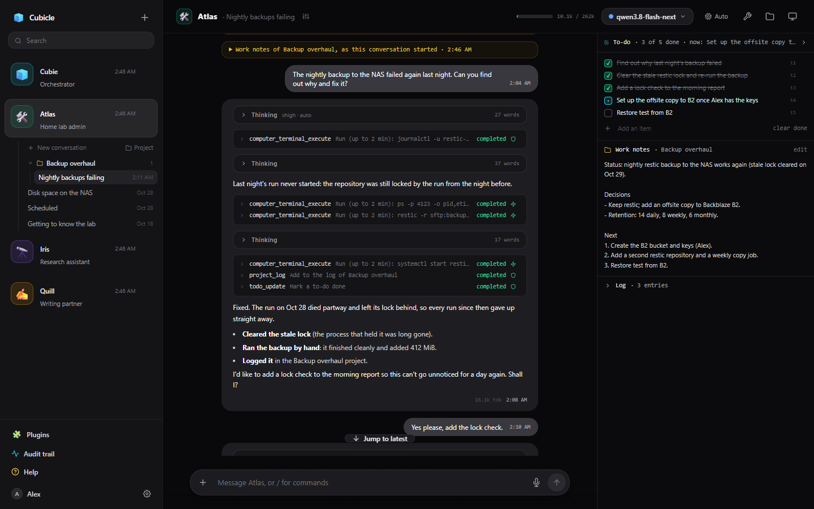
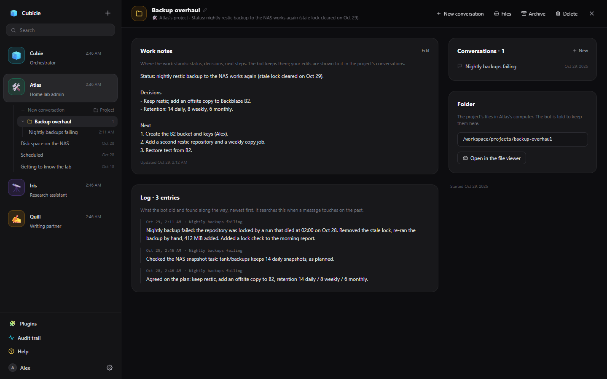

# Cubicle

**A workspace for AI bots that do real work, on hardware you own.**

Cubicle gives each of your bots a desk of its own: a chat, notes it keeps between conversations,
projects, a to-do list, and a sandboxed computer where it runs commands and browses the web. You watch
what it does, step by step, and it asks before anything risky. It runs on your own server, with a model
on your own machine or any OpenAI-compatible service, and several people can share it.



## What it's like

**Bots that show their work.** A reply lays out what the bot did, in order: its thinking, each tool it
used, what came back. Click a step to see the exact command and its output.


**You stay in charge.** Anything that changes something, reaches out or could do harm stops at an
approval card. Let the routine things through without asking: trust a tool, always allow a command, or
let a small decision model approve the low-risk actions and hold the rest for you. Everything is in the
audit trail.


**A computer of its own.** Each bot gets an Ubuntu desktop with a browser, a terminal and its files. Watch
it live, take control when it needs a human, or show it how to do something once and it writes up the
procedure for next time.


**Work that lasts longer than a chat.** Projects keep the work notes, a log of what happened and a folder
together across conversations. Notes hold what a bot needs to know about its job; the to-do list holds
the plan for the job at hand.



**And the rest:**

- **Thinking that fits the question**: set how hard a bot thinks, or let Auto decide per message.
- **Cubie**, the orchestrator, makes bots for you and hands them work.
- **Connected apps** (Gmail, GitHub, Drive and hundreds more through Composio) and **MCP servers**.
- **Schedules**: prompts a bot runs on its own, with checks that only wake it when something changed.
- **Secrets** a bot can use without ever seeing them.
- **Sharing**: accounts for everyone on the server, and bots you can share with teammates.
- **Help built in**: ask any bot how Cubicle works and it answers from these docs, for its own settings.


## Quick start

You need Docker with Compose, and a model server that speaks the OpenAI API (a local one such as
llama.cpp, Ollama, LM Studio or halogen-flash-server, or a hosted one such as OpenRouter).

```bash
git clone https://github.com/cannibal3004/cubicle.git
cd cubicle
cp .env.example .env          # set SITE_ADDRESS to the address you will open
docker compose up --build -d
```

Open that address, create the owner's account, and point **Settings → Model server** at your model
server. To give bots their own computers, add `COMPUTER_PROVIDER=docker` and `COMPOSE_PROFILES=computer`
to `.env` and run the last command again.

The full guide: [Installing](docs/admin/install.md).

## Documentation

Everything is in [docs/](docs/README.md), and inside Cubicle under **Help**:

- **Using Cubicle**: [getting started](docs/getting-started.md), [chatting](docs/chat.md),
  [projects](docs/projects.md), [notes and to-dos](docs/notes-and-todos.md), [files](docs/files.md),
  [thinking](docs/thinking.md)
- **Your bots**: [settings](docs/bots.md), [tools and approvals](docs/approvals.md),
  [the computer](docs/computer.md), [apps and MCP](docs/apps-and-mcp.md), [secrets](docs/secrets.md),
  [schedules](docs/schedules.md), [sharing](docs/sharing.md), [Cubie](docs/cubie.md)
- **Running Cubicle**: [installing](docs/admin/install.md), [App Settings](docs/admin/settings.md),
  [configuration](docs/admin/configuration.md), [how it works](docs/admin/architecture.md),
  [API](docs/admin/api.md), [troubleshooting](docs/admin/troubleshooting.md)

## Status

Cubicle is a personal project in active development, used every day on a home lab and at work. Some
things to know before you rely on it:

- The bots' computers are sandboxes for a bot's work, not hardened browsers for hostile sites: they have
  internet access, and anything signed in there is reachable by the bot.
- Scrubbing secrets from tool output guards against accidents; it is not a security boundary.
- It is tested most with Qwen3.8 Flash Next on halogen-flash-server and with models on OpenRouter. Any
  OpenAI-compatible server should work; tool calling depends on the model.

## Credits

Cubicle started as a fork of [open-grok-bot](https://github.com/Anil-matcha/open-grok-bot) by Anil
Chandra Naidu Matcha. It is an independent project and is not affiliated with xAI.

## Contributing

Issues and pull requests are welcome. Keep the docs in step with the code (a UI change usually means
re-taking the screenshots: [one command](docs/admin/screenshots.md)), and never include secrets, personal
data or transcripts.

This repository does not include a license file yet.
