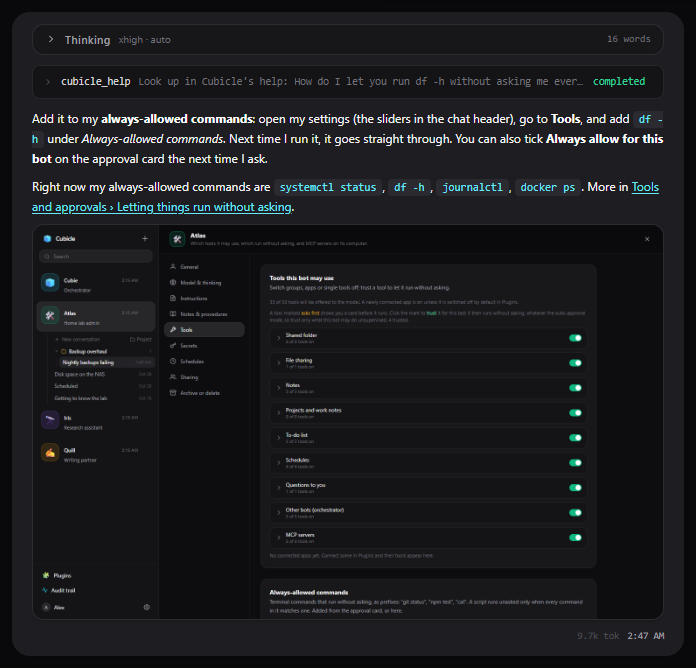

# Cubicle help

Cubicle gives each of your AI bots a desk of its own: a chat, notes, a to-do list, projects, and a
sandboxed computer it can work on. You decide what each bot may do, and it asks before anything risky.

These pages explain how it works. In Cubicle they are under **Help** in the sidebar, and any bot can look
things up in them for you: ask it "how do I share a bot?" and it answers from here, with your own
settings in mind.

## Using Cubicle

- [Getting started](getting-started.md): the screen, your first bot, your first conversation
- [Chatting with a bot](chat.md): the message box, thinking, tool steps, slash commands, undo, links
- [Projects](projects.md): pieces of work with their own notes, log and folder
- [Notes, work notes and to-dos](notes-and-todos.md): what a bot remembers, and where
- [Files and attachments](files.md): attaching files, the shared folder, files a bot hands you
- [Thinking and Auto](thinking.md): how hard a bot thinks, and letting Auto decide

## Your bots

- [Bot settings](bots.md): name, model, instructions, tools, and the rest of a bot's page
- [Tools and approvals](approvals.md): approval cards, auto-approval, trusted tools, the audit trail
- [The bot's computer](computer.md): the desktop, files, taking control, showing the bot how
- [Connected apps and MCP servers](apps-and-mcp.md): Gmail, GitHub and friends; MCP tool servers
- [Secrets](secrets.md): API keys a bot can use without seeing them
- [Schedules](schedules.md): prompts that run on their own
- [Sharing a bot](sharing.md): letting teammates use a bot of yours
- [Cubie, the orchestrator](cubie.md): the bot that makes bots and hands out work

## Running Cubicle

- [Installing](admin/install.md): Docker Compose, HTTPS on a LAN, the computer runtime, backups
- [App Settings for admins](admin/settings.md): the model server, users, auto-approval, connectors
- [Configuration](admin/configuration.md): every environment variable
- [How it works](admin/architecture.md): the pieces, a turn from start to finish, the tools
- [API](admin/api.md): the HTTP routes, for scripts
- [Troubleshooting](admin/troubleshooting.md)
- [Updating these screenshots](admin/screenshots.md)
