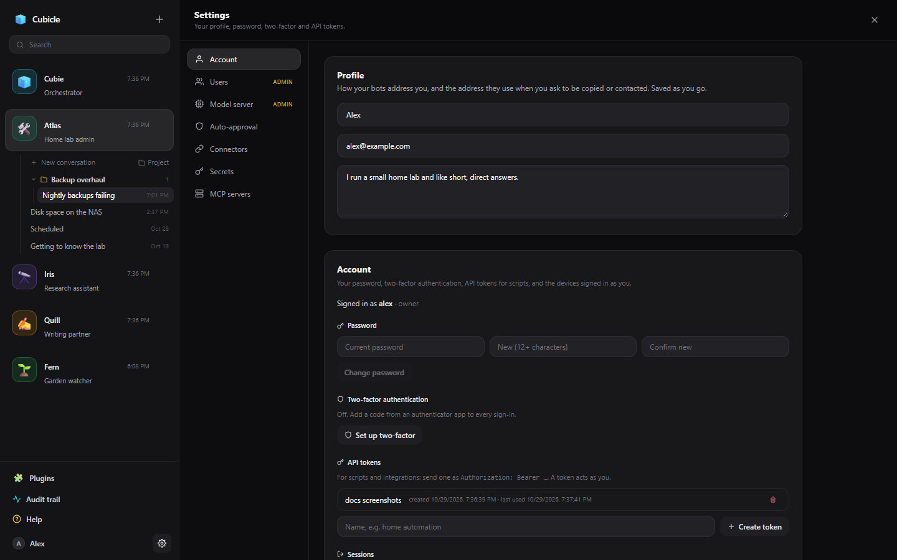
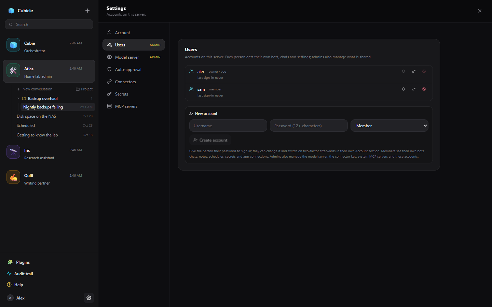
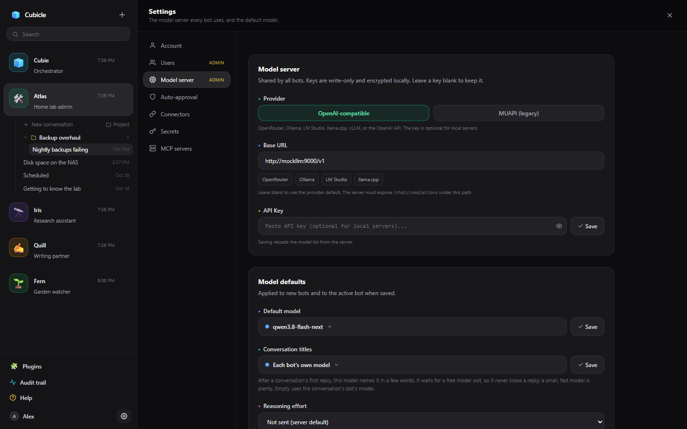
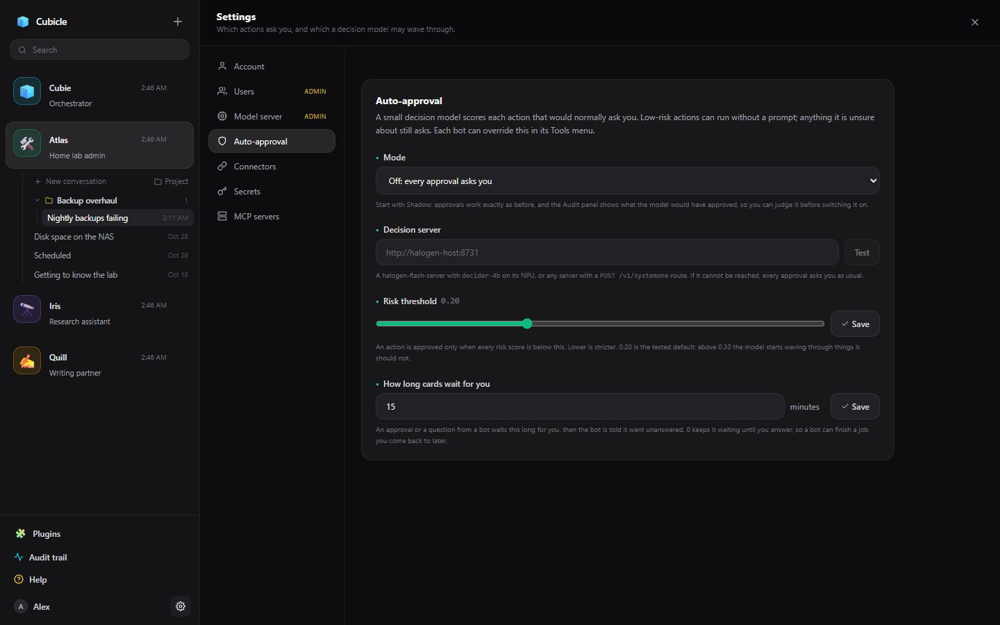

# App Settings for admins

**Settings** (the gear at the bottom of the sidebar) has a section for everyone and sections only admins
change. The first account is the owner and an admin; admins can make others admins.

## Account (everyone)

Your name, email and a few lines about you (your bots use them to address you and to copy you on
things), your password, two-factor authentication (any authenticator app, with recovery codes), API
tokens for scripts (sent as `Authorization: Bearer <token>`), and the devices you are signed in on.

## Users

Accounts on this server. **New account** makes one with a username, a starting password and a role:
**Member** or **Admin**. Each person gets their own bots, conversations, notes, schedules, secrets and
app connections, and can only reach their own; they can share bots with each other
([Sharing a bot](../sharing.md)). Admins also manage what is shared by everyone: the model server, the
connector key, the decision server and system MCP servers. From the list you can promote, disable or
reset an account's password.

## Model server

- **Provider**: OpenAI-compatible for almost everything (OpenRouter, a local server, OpenAI), or the
  legacy MUAPI.
- **Base URL**: presets fill in the usual ones (OpenRouter, Ollama, LM Studio, llama.cpp). Local
  servers need the URL to end in `/v1`.
- **API key**: write-only and stored encrypted; leave it blank to keep the stored one. Optional for
  local servers.
- **Default model**: what new bots start with.
- **Conversation titles**: the model that names a conversation after its first reply; a small, fast one
  is plenty. Empty uses each conversation's own model.
- **Reasoning effort**: the default [thinking level](../thinking.md), or "Not sent" to leave it to the
  server.
- **Requests at a time**: how many requests may run at the model server together, shared round-robin
  between accounts so one person's bots cannot crowd out another's. The rest wait, and the chat shows
  their place in line.
- **Retrieval**: whether long attachments and project logs are indexed with the server's embedding
  model, and which embedding and reranking models to use.
- **Tools per turn**: when a bot could be offered more tools than this in one go, its connected apps'
  tools are narrowed to the ones that match the conversation.
- **Screenshots to the model**: computer screenshots are scaled to this width before they go to the model.

## Auto-approval

The default mode (Off, Shadow or On), the decision server (with **Test**), the risk threshold, and how
long approval cards and a bot's questions wait for an answer. Bots can override the mode and the
threshold. See [Tools and approvals](../approvals.md#auto-approval).

The decision server is a small model that answers yes/no questions: `decider-4b` on a
halogen-flash-server, or any server with `POST /v1/systemone`. [Auto thinking](../thinking.md#auto) uses
it too. Start in Shadow and compare its verdicts in **Audit trail → Auto-approval** before turning it on.

## Connectors

The Composio API key that powers [connected apps](../apps-and-mcp.md#connected-apps). Without it, the
Plugins page shows a preview of the catalog.

## Secrets

Your own secrets for all your bots (each account has its own). See [Secrets](../secrets.md).

## MCP servers

Your MCP servers, and for admins the system-wide ones every account's bots get. See
[Connected apps and MCP servers](../apps-and-mcp.md#mcp-servers).
