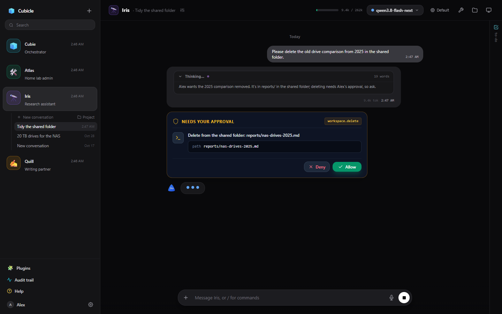
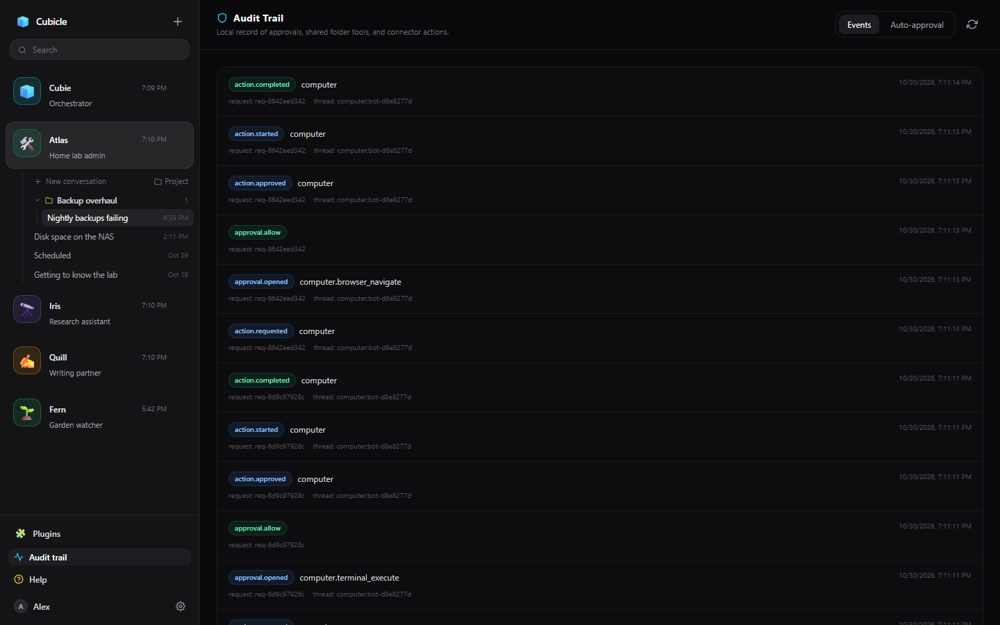

# Tools and approvals

Bots work through tools: reading and writing files, running commands on their computer, browsing,
using your connected apps, keeping their notes. Tools that only look (reading a file, listing a folder,
reading the notes) run straight away. Anything that changes something, reaches out, or could do harm
asks you first.

## Approval cards

When a bot wants to do something that needs your approval, the reply pauses and a card shows exactly
what it wants to do: the command, the file and the change, the message it would send. **Allow** lets it
run; **Deny** tells the bot no, and it stops and asks you how to go on instead of trying again.

- The sidebar marks a bot that is waiting for you, and cards from bots shared with you that you may
  answer appear at the top of the sidebar.
- A card waits 15 minutes by default (an admin can change it). If nobody answers, the bot is told and
  carries on without it.
- On a terminal command, the card can offer **Always allow for this bot** for the command's shape
  (`systemctl status`, `df -h`); tick it and allow, and next time it runs without asking.

## Letting things run without asking

There are three ways, from narrow to broad:

- **Always-allowed commands**: terminal commands, as prefixes. A script runs unasked only when every
  command in it matches one. Set them on the bot's settings page under Tools, or from an approval card.
- **Trusted tools**: on the bot's settings page under Tools, click the mark on a tool to trust it for
  that bot: it runs without asking, whatever else is set. Trust only what the bot may do unsupervised.
- **Auto-approval**: a decision model approves the low-risk actions (below).

Steps that ran this way say so: **🛡** for a trusted tool or an always-allowed command, **⚡** for
auto-approval. Hover the step to see why.

## Auto-approval

With auto-approval on, the approval card still opens, and a small decision model scores the action
while it is up. When every risk score is low, it answers the card for you; anything it is unsure about,
or cannot score, waits for you as usual.

The model is asked plain yes/no questions about the action and the message that led to it: does it
permanently delete or discard data, upload local data somewhere, read secrets or change system settings,
download and run code, or do something that can't be undone, such as sending a message? It sees the
tool, what it was given (a path and a size, never a file's contents) and your latest message. It never
sees tool output, so text the bot read cannot talk it into anything. Two things are decided by rule: a
write that shrinks a file to a quarter of its size or less is always held, and mouse and keyboard input
on the bot's computer is not scored.

There are three modes:

- **Off**: every approval asks you.
- **Shadow**: approvals ask you as before, and the model's verdicts are only recorded. Start here, and
  compare them in **Audit trail → Auto-approval** with what you actually decided.
- **On**: the model answers the cards it is sure about.

An admin sets up the decision server and the default mode in App Settings. Each bot can override the
mode and the **risk threshold** (Bot settings → Model & thinking, or the tools button in the chat
header). The threshold is how low every score must be: 0.2 is strict; fetching web pages scores around
0.3 to 0.6 as "downloads code", so a research bot that should read the web unattended wants 0.5 or more.

`/auto off|shadow|on|inherit` sets the bot's mode from the message box.

## The audit trail

**Audit trail** in the sidebar lists what was asked, approved, denied and run, newest first.
**Auto-approval** shows each action the decision model scored: what it saw, its scores, its verdict and
what was finally decided, including actions you denied that it would have let through.
