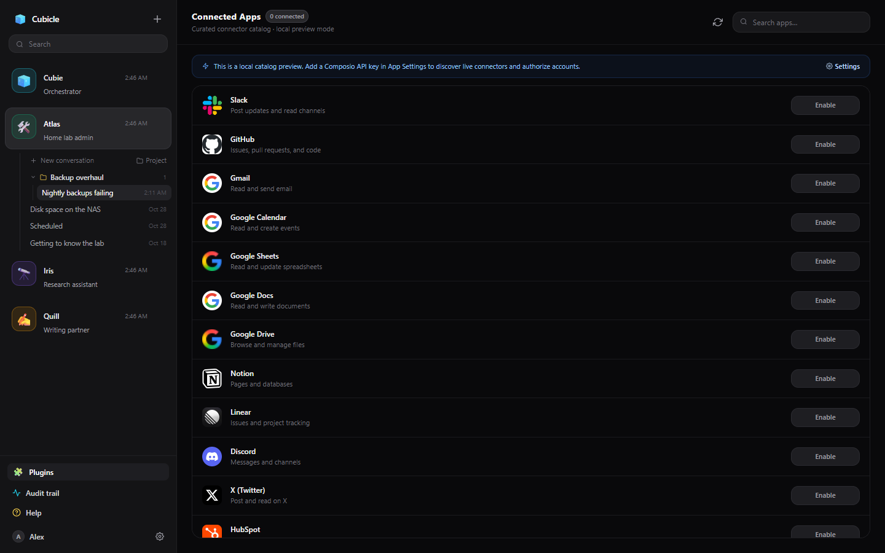
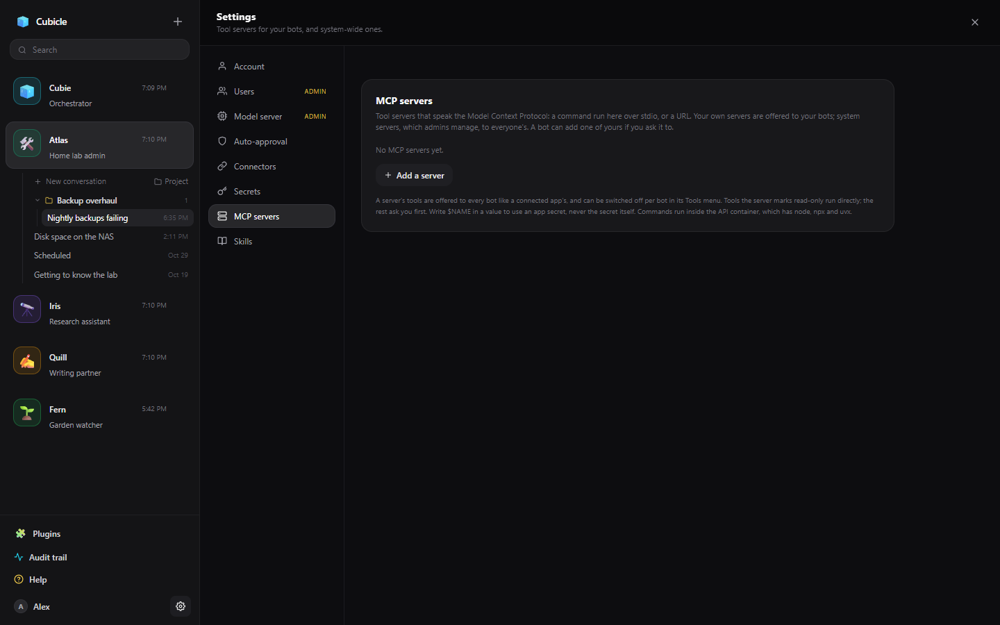

# Connected apps and MCP servers

Two ways give your bots tools beyond their own: **connected apps** (Gmail, GitHub, Google Drive,
Slack and hundreds more, through Composio) and **MCP servers** (any tool server that speaks the Model
Context Protocol).

## Connected apps

**Plugins** in the sidebar lists the apps you can connect. **Enable** starts the app's own sign-in in a
new tab; once you are through, its tools are offered to your bots. (An admin first adds a Composio key
in App Settings → Connectors; until then the page shows a preview of the catalog.)

- Each app's switch on the Plugins page sets whether bots get it **by default**. A bot can still switch
  an app on or off for itself: Bot settings → Tools, or the tools button in the chat header.
- Tools that only read (list emails, search issues) run straight away. Tools that change something (send
  an email, open a pull request) ask you first, like any [approval](approvals.md).
- A bot can also start a connection for you (`connector_connect`) when a job needs an app you have not
  connected yet; it asks first and gives you the sign-in link.

When a bot could be offered a great many app tools at once, Cubicle offers the ones that match the
conversation and keeps that choice for the conversation. If a job needs an app's tools that were not
offered, name the app in a message ("use GitHub for this") and they are added.

## MCP servers

An MCP server can be a command (`npx -y @upstash/context7-mcp`, `uvx some-server`) or a URL (a vendor's
hosted MCP endpoint). A URL server may speak streamable HTTP or the older SSE protocol: both are tried,
SSE first when the path has `/sse` in it, and a server reached over SSE says so in its status. Choose
**URL (SSE only)** to skip the other. There are three places one can live:

| Where | Who gets its tools | Where you add it |
| --- | --- | --- |
| Yours | All your bots | App Settings → MCP servers |
| System-wide (admins) | Every account's bots | App Settings → MCP servers |
| A bot's own | That bot only: a command runs inside the bot's computer, a URL is reached from the server | Bot settings → Tools → This bot's MCP servers |

- **Test** connects and lists the server's tools before you save.
- Never put a key in a server's definition: write `$NAME` as an environment or header value and the
  [secret](secrets.md) `NAME` is used when the server starts. A value typed in directly is shown as
  `********`, to you and to the bots.
- The pencil button edits a server. Hidden values left as `********` keep what is stored; the server
  reconnects when you save.
- Tools the server marks read-only run straight away; anything else asks. Mark a server **trusted
  read-only** when it cannot change anything (documentation and search servers), and all its tools run
  without asking.
- Each server's tools appear like a connected app's, named `<server>_<tool>`, and can be switched per
  bot (Bot settings → Tools, where a long list has a search box and all on / all off).
- **Choosing a server's tools.** Some servers list hundreds of tools (DigitalOcean's has over 400).
  Edit the server and tick the ones its bots may have: search, tick a whole family (`droplet_*`) at
  once, and say whether tools it adds in a later version are offered too. The list shows "offers 12
  of 412"; a server offering more than 60 tools with no choice made is flagged. Some servers can also
  be narrowed where they start (`@digitalocean/mcp --services droplets,apps`).
- A bot can add a server itself (`mcp_add_server`, which asks first): for a bot's own server it
  installs it with its terminal, adds it, and reports the tools it found.
