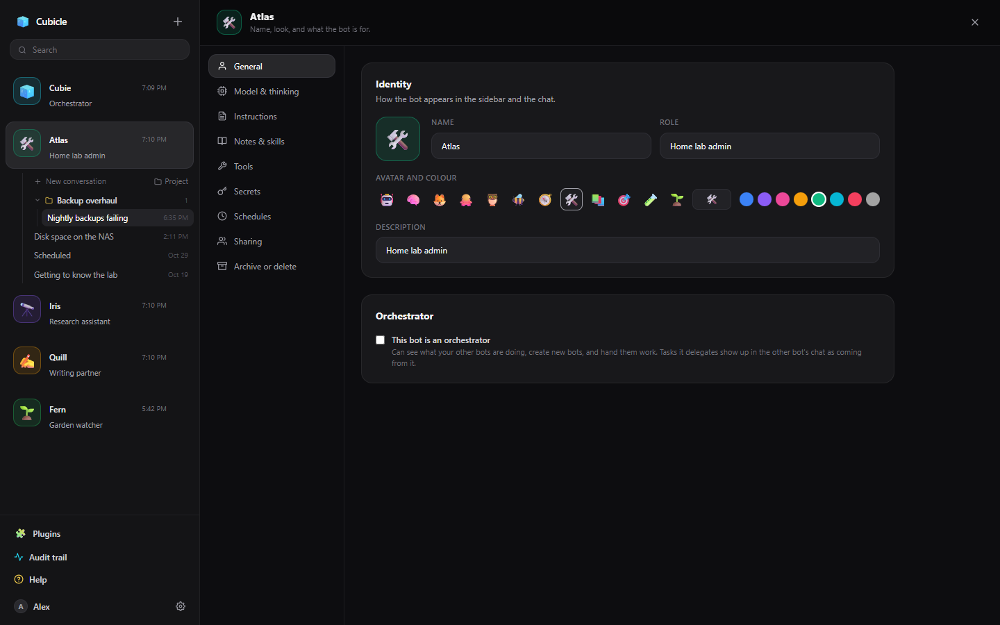
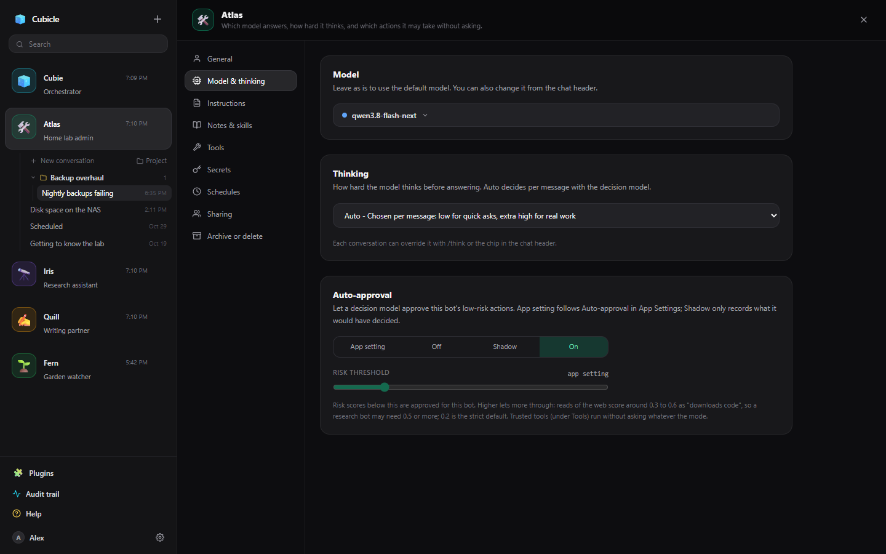
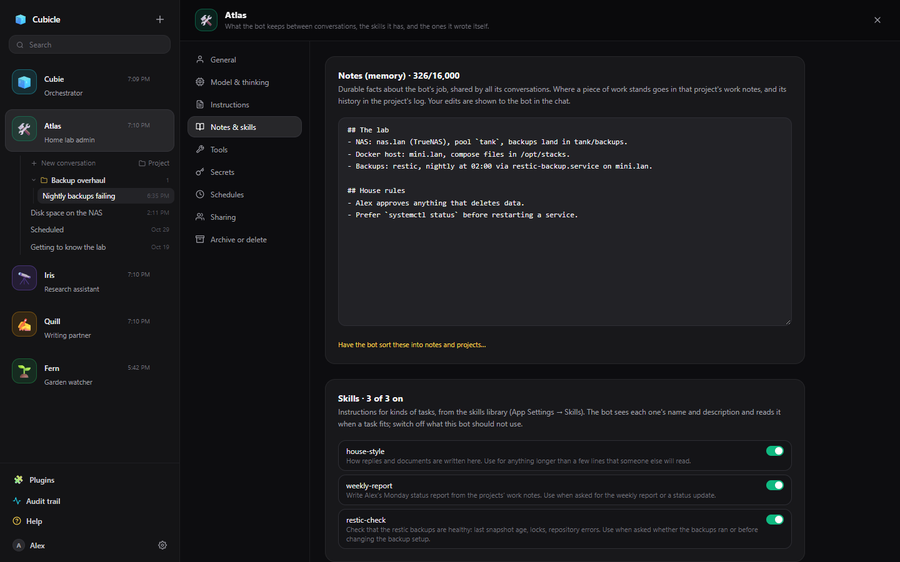
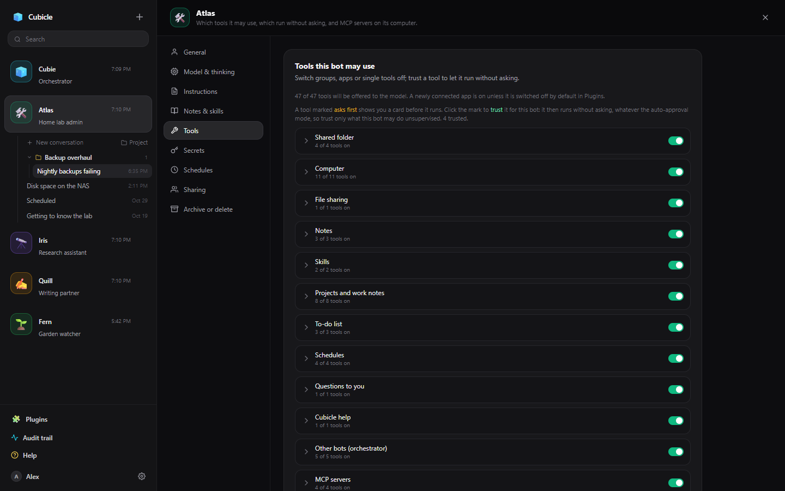

# Bot settings

Each bot has a settings page. Open it with the sliders button in the chat header, or **Settings** in a
bot's **⋯** menu in the sidebar.

Changes to the bot's own settings are collected as you go: a bar at the bottom says which sections have
unsaved changes, with **Save** and **Discard**, and a dot marks those sections in the list. Secrets,
schedules, MCP servers and sharing save themselves as you change them. Closing the page, or opening
another bot's, with unsaved changes asks first. The page stays put while you visit the chat, so a
half-finished edit waits for you.

## General

The bot's name, role, avatar, accent colour and description (shown in the sidebar). **Orchestrator**
makes it a bot like [Cubie](cubie.md) that can see your other bots and hand them work.

## Model & thinking

- **Model**: the model this bot uses. You can also switch it from the chat header, or with `/model`.
- **Thinking**: how hard it thinks before answering, or **Auto** to decide per message. See
  [Thinking and Auto](thinking.md).
- **Auto-approval** and **Risk threshold**: whether a decision model may approve this bot's low-risk
  actions without asking you. See [Auto-approval](approvals.md#auto-approval).

## Instructions

The system prompt: who the bot is and how it works. Keep it to the job and the house rules; facts the
bot learns as it goes belong in its notes. **Suggestion cards** are the starter prompts an empty
conversation shows; **Draft some for me** writes a few from the bot's instructions.

## Notes & skills

- **Notes**: what the bot keeps between conversations. See
  [Notes, work notes and to-dos](notes-and-todos.md).
- **Skills**: the skills library, with a switch per skill for this bot. See [Skills](skills.md).
- **Skills this bot wrote**: how-tos the bot wrote itself, most from what you showed it on its
  computer. It reads one before a task it covers. See [Showing the bot how](computer.md#showing-the-bot-how).

## Tools

- **Tools this bot may use**: switch groups of tools, connected apps or single tools off. Click the
  mark on a tool that asks first to **trust** it: it then runs without asking, whatever the
  auto-approval mode.
- **Always-allowed commands**: terminal commands that run without asking, as prefixes (`git status`,
  `df -h`). A script runs unasked only when every command in it matches one. You can also add one from
  an approval card.
- **MCP servers on this computer**: tool servers that run inside this bot's computer, for this bot
  alone. See [Connected apps and MCP servers](apps-and-mcp.md).

The tools button in the chat header is a quicker way to switch whole groups and apps, and to change
auto-approval.

## Secrets, Schedules, Sharing

- [Secrets](secrets.md): API keys and tokens for this bot's computer.
- [Schedules](schedules.md): prompts the bot runs on its own.
- [Sharing](sharing.md): teammates who can use this bot.

## Archive or delete

**Archive** hides the bot from the sidebar and keeps everything; unarchive it from the sidebar's
**Archived** list. **Delete** removes the bot, all its conversations and its computer, for good. On a
bot someone shared with you, this section is **Leave** instead.

## Making a bot

**+** at the top of the sidebar opens the same page for a new bot, with General, Model & thinking,
Instructions and Tools. **Create bot** makes it and keeps the page open on it, with every section.
