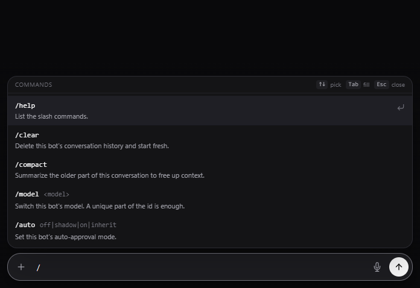
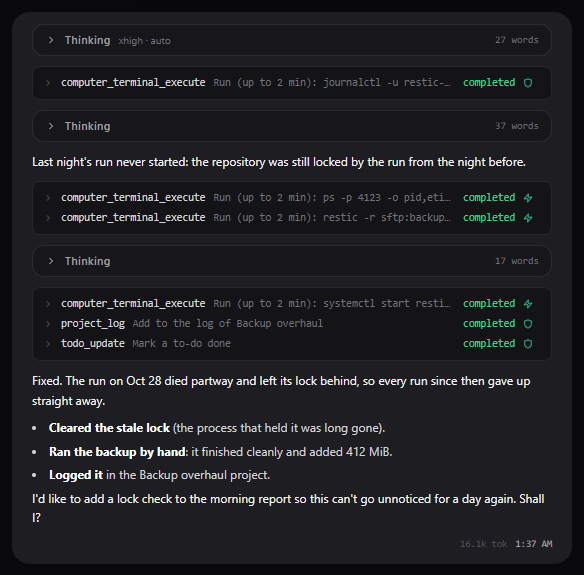
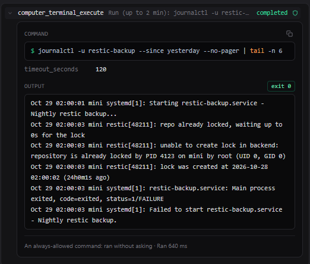

# Chatting with a bot

## The message box

- **Enter** sends; **Shift+Enter** adds a line. The box grows as you write.
- **+** attaches images and files; you can also drop them on the box or paste them. See
  [Files and attachments](files.md).
- **The microphone** dictates, in browsers that support it (over HTTPS from another machine).
- **The round button** sends. While a reply is streaming it turns into **Stop**; what the bot had written
  so far is kept.
- **/** opens the slash command picker (below).
- **↑** in an empty box takes back your last message to edit it (see [Undo and redo](#undo-and-redo)).

A reply runs on the server, not in your browser: you can close the tab, reload, or open the same
conversation on another machine, and the chat picks the reply up where it is.

## A reply

A reply shows what the bot did, in the order it did it:

- **Thinking**: what the model worked through before acting, one block per step of the reply. A block
  is open while the bot is thinking and folds away when it moves on; click it to read it again. See
  [Thinking and Auto](thinking.md).
- **Tool steps**: each tool the bot used, with what it did and how it went. A green **⚡** means the
  decision model approved it, a **🛡** that it is a trusted tool or an always-allowed command. Hover a
  step for a summary; click it to fold out the details.
- **Text**: what the bot wrote between steps, and its answer.

A step's details show what it was given (a terminal call shows the full command, ready to copy), what
came back (a command's exit code, its output and its errors), how it was allowed, and how long it ran.

The footer of a reply shows its token count and time. Switch on **Show generation speed under
replies** (App Settings → Account → Display) to add how fast the model went: tokens per second, and
the time to the first token (mostly the model reading the prompt). Hover it for the detail.

## Questions from the bot

A bot can ask you something and wait for the answer: a card with the choices, and a box for an answer of
your own, appears in the chat, and the sidebar marks the bot as waiting. The reply carries on once you
answer.

## Undo and redo

- **The pencil** next to one of your messages (on hover) takes it back, with everything after it, and
  puts it in the box to change and send again.
- **/undo** takes back your last message and the reply to it.
- **/redo** brings back what undo or the pencil took out, until you send something new.

Things the bot did (files written, commands run) stay done; when an undo would pass some, Cubicle shows
you the list and asks first.

## Slash commands

| Command | What it does |
| --- | --- |
| `/help` | Lists the commands |
| `/think auto\|off\|low\|medium\|xhigh\|default` | How hard the model thinks in this conversation |
| `/model <model>` | Switches this bot's model; part of the name is enough |
| `/auto off\|shadow\|on\|inherit` | This bot's [auto-approval](approvals.md#auto-approval) |
| `/stop` | Stops the reply that is streaming |
| `/undo`, `/redo` | See above |
| `/compact` | Summarizes the older part of the conversation to free up context |
| `/clear` | Empties this conversation |
| `/computer` | Opens the bot's [computer](computer.md) |
| `/audit` | Opens the [audit trail](approvals.md#the-audit-trail) |
| `/settings` | Opens your settings |
| `/shared list\|read\|write\|delete <path>` | Works in the [shared folder](files.md#the-shared-folder) directly, with your approval |

## Long conversations

The meter in the header (for example `10.1k / 262k`) shows how much of the model's context the
conversation uses. When it passes about 70%, Cubicle compacts it: the model summarizes the older part,
the summary goes in the conversation as a marker you can open, and the conversation carries on from
there. The bot's [notes, work notes and to-do list](notes-and-todos.md) survive a compaction whole.
`/compact` does it on demand.

## Conversations

- **New conversation** under a bot starts one. The first reply names it.
- Hover a conversation in the sidebar to rename it, move it into a [project](projects.md), archive or
  delete it. A bot's first conversation can be emptied but not deleted.
- **Search** at the top of the sidebar finds bots by name, and after three letters searches inside the
  conversations as well.
- Each conversation has an address (`/c/<id>`) for bookmarks and links, and the back button moves
  between the conversations and [project pages](projects.md) you opened.
