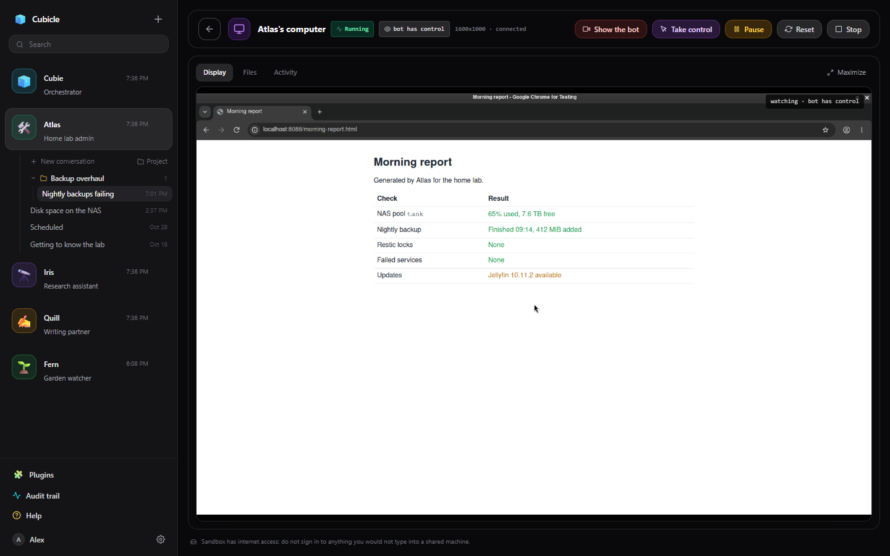
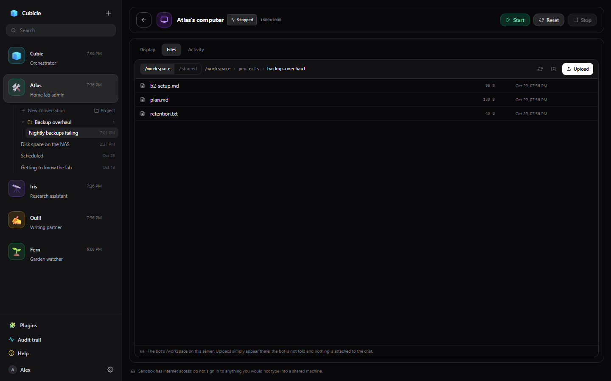

# The bot's computer

Each bot can have a computer of its own: a sandboxed Ubuntu desktop with Chromium, a terminal and a
file manager, where it runs commands, browses the web and keeps its files. You can watch it live, take
control of it, and show it how to do things. (An admin turns the computer runtime on; see
[Installing](admin/install.md#the-computer-runtime).)

Open it with the monitor button in the chat header, or `/computer`.

## Starting and stopping

The computer starts itself the first time the bot needs it; **Start** boots it yourself. **Pause**
freezes it, **Stop** shuts it down, and **Start** brings it back with its files, home directory and
installed packages. **Reset** starts over: it wipes the home directory and the installed packages and
keeps `/workspace`.

What persists:

- `/workspace`: the bot's own files and projects.
- The home directory: virtual environments, npm and cargo installs, browser profile, dotfiles.
- The packages the bot installed with `computer_install_packages` (it asks first; the shell has no sudo).

`/tmp` is wiped at every start. `/shared` is the [shared folder](files.md#the-shared-folder).

## Watching and taking control

The **Display** tab shows the desktop live. **Take control** lets your mouse and keyboard through,
while the bot's clicks and typing are held (it can still take screenshots); **Hand back to bot**
returns it. **Maximize** fills the window with the desktop.

A bot can ask you to take over when it needs a human (a sign-in, a CAPTCHA, a check): a card appears in
the chat and on the computer page, and when you hand control back the message box is ready with a note
telling it to carry on.

The computer has internet access. Do not sign in to anything there you would not type into a shared
machine.

## Files

The **Files** tab browses the computer's `/workspace` and the shared folder: open, preview, download,
upload, make folders and delete. A [project's](projects.md) **Files** button opens its folder here.

## Activity

The **Activity** tab shows the computer's state: whether it is running, who has control, its screen
size, the last operation, the page its browser is on, and the packages installed. What the bot did is in
its replies' [tool steps](chat.md#a-reply) and the [audit trail](approvals.md#the-audit-trail).

## Background jobs

A bot can start a long command (a big copy, a build, a scan) as a **background job**: the command runs
on in the computer while the bot carries on, and you can keep talking to it. When the job ends, the
conversation it was started from gets a message with its exit code, how long it ran and the end of its
output, marked **background job ended**. If the bot is idle that starts a reply at once; if it is in
the middle of one, the message waits for that reply to end. Several jobs that end together arrive as
one message. A job that never exits on its own (a server) is started without this.

## Checking scripts

When a bot saves a shell script (`.sh`, `.bash`, or a file starting with a shell `#!` line) or a Python
file with its file tools, the computer checks it on the spot: shell with
[ShellCheck](https://www.shellcheck.net), Python with [Ruff](https://docs.astral.sh/ruff/) for real
errors (syntax errors, undefined names). Problems come back with the save, so the bot fixes the
script before running it; style notes are left out, and nothing is ever refused. Both tools are
installed in the computer for the bot to run itself too.

## Showing the bot how

**Show the bot** gives you control and records what you do in the computer's browser. Do the task
once, then press the button again: it hands the desktop back and sends the steps, with a few frames, to
the bot in the chat. The bot writes them up as a [skill](skills.md) of its own (a short how-to in its
settings, under Notes & skills). Before a task the skill covers, the bot reads it and follows it.

## One computer, many conversations

A bot's conversations share its computer. When one conversation is running something that changes the
computer, another conversation's change waits its turn, and its step says what it is waiting for.
