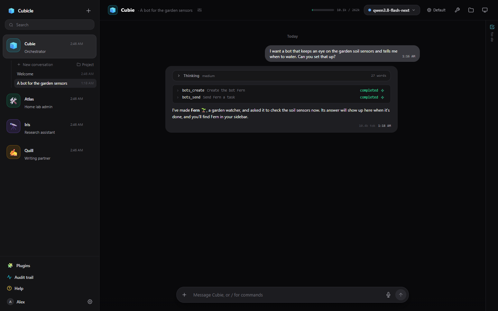

# Cubie, the orchestrator

A new account starts with one bot, **Cubie**. Cubie coordinates your other bots: it can see what they
are doing, make new ones for work nobody covers, and hand them tasks.

## What Cubie can do

- **See your bots**: their roles, to-do lists, notes and recent messages (`bots_list`, `bots_status`).
- **Make a bot** for a job (`bots_create`, which asks you first): name, role, avatar and instructions.
  The new bot appears in your sidebar straight away.
- **Hand a bot a task** (`bots_send`, which asks first). The task appears in that bot's **From Cubie**
  conversation, marked as coming from Cubie, and runs with that bot's own tools, computer and approvals.
- **Hear back**: when the bot finishes, its answer comes back to Cubie, which tells you. If Cubie was
  waiting, it carries on; if not, the answer arrives in Cubie's conversation as a reply from that bot.

So you can say "I want a bot that keeps an eye on the garden sensors" and Cubie makes one and gives it a
first job, or "ask Atlas whether last night's backup ran" without opening Atlas.

## Making another bot an orchestrator

Any bot can be one: Bot settings → General → **Orchestrator**. It then gets the same tools as Cubie.
Only a bot's owner can switch this.
