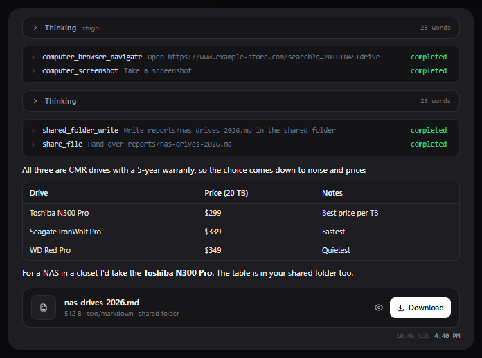

# Files and attachments

## Attaching files to a message

Press **+** in the message box, drop files on it, or paste them. You can attach several at once.

- **Images** go to the model with your message, when the model can see images.
- **Other files** (PDF, Word, Excel, PowerPoint, CSV, text, code) are saved where the bot can work on
  them: in its computer's `/workspace/uploads`, or in the shared folder if it has no computer. Their
  text is extracted and put in your message, up to a limit; for a longer file the bot is told where the
  whole file is and opens it with its tools.
- A long attachment is also indexed: later messages that ask about it bring the matching passages along
  with them, so the bot can answer from the right part of the file without rereading it all.

Files up to 50 MB can be attached. Nothing leaves your server except as part of the model request.

## Files a bot hands you

A bot can hand you a file from its computer or the shared folder with `share_file`. It appears in the
reply as a card: **Download** saves it, and the eye previews it (text, code with syntax colours,
images, PDFs).

## The shared folder

The shared folder is a directory on the server that you and every bot can reach, for files you want to
find outside the chat. A bot with a [computer](computer.md) sees it at `/shared` and works there with
its ordinary file tools and shell; a bot without one uses the `shared_folder_*` tools. Writing and
deleting there asks for your approval.

You can work in it directly with `/shared list`, `/shared read <path>`, `/shared write <path>` (the
content on the next line) and `/shared delete <path>`.

## Browsing a bot's files

The **Files** tab of a bot's [computer](computer.md#files) (the folder button in the chat header) shows
its `/workspace` and the shared folder. You can open, preview, download, upload, make folders and
delete there. Uploads simply appear: the bot is not told, so mention them in the chat when it should use
them.
