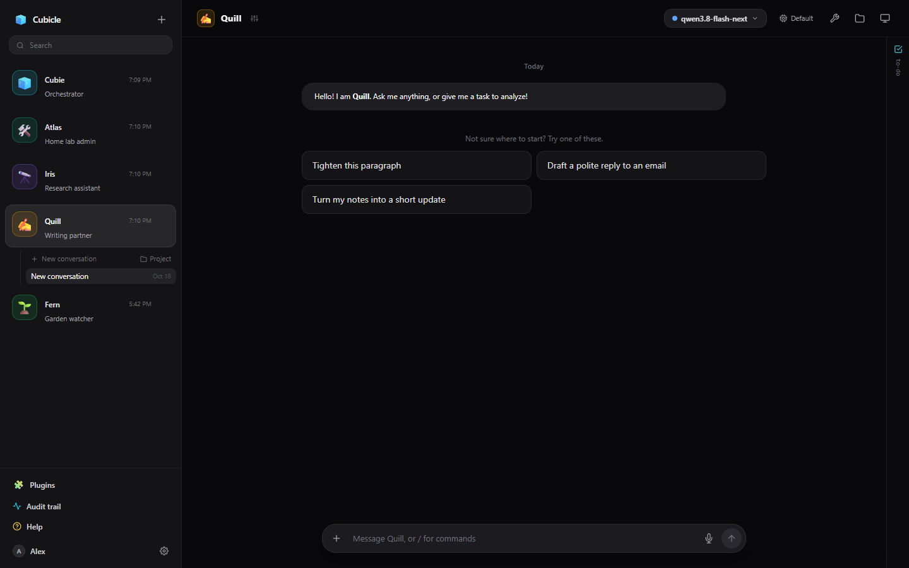

# Getting started

## The screen

- **The sidebar** on the left lists your bots. Click one to open it; under the open bot are its
  conversations and [projects](projects.md). A blue dot means a bot is working on a reply, an amber one
  that it is waiting for you (an approval or a question).
- **The chat** in the middle is the open conversation. Its header shows the bot, the conversation's
  title, how full the context is, the model, the [thinking level](thinking.md), and buttons for the
  bot's tools, its files and its [computer](computer.md).
- **The to-do panel** on the right shows the conversation's [to-do list and work notes](notes-and-todos.md).
  Click its header to fold it away.
- At the bottom of the sidebar are **Plugins** ([connected apps](apps-and-mcp.md)), the **Audit trail**
  ([what was approved and run](approvals.md#the-audit-trail)), **Help**, and your **Settings**.

## Your first bot

A new account starts with one bot, [Cubie](cubie.md), which can make others for you: tell it what you
need ("I want a bot that keeps an eye on my servers") and it sets one up.

To make one yourself, press **+** at the top of the sidebar. Give it a name and an avatar, pick a
model, and write a few lines in **Instructions** about who it is and how it should work. That is
enough to start; everything else can be changed later on the [bot's settings page](bots.md).

## Your first conversation

Type in the message box and press **Enter** (Shift+Enter adds a line). An empty conversation offers the
bot's suggestion cards; click one to put it in the box.

The reply streams in. When the bot uses a tool, the step appears in the reply where it happened, and
anything risky stops for your approval first: see [Tools and approvals](approvals.md).

Each bot can have many conversations. **New conversation** under the bot starts one; the first reply
gives it a title. A conversation has its own address (`/c/...`), so you can bookmark it, link to it, or
go back to it with the browser's back button.

## Where to go next

- [Chatting with a bot](chat.md) covers the message box, slash commands, undo and the rest.
- [Projects](projects.md) keep longer pieces of work together.
- [The bot's computer](computer.md) is where a bot runs commands and browses the web.
