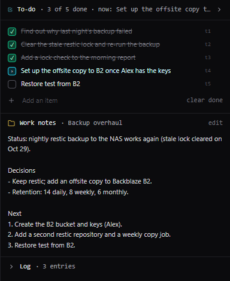

# Notes, work notes and to-dos

A bot keeps three kinds of written memory, each for a different job, and can also keep an
[automatic memory](#automatic-memory) of the facts of its conversations.

| | What it is for | Where it lives | Where you see it |
| --- | --- | --- | --- |
| **Notes** | Durable facts about the bot's job: the systems it looks after, how to reach them, house rules, lessons learned | The bot, shared by all its conversations | [Bot settings](bots.md) → Notes & skills |
| **Work notes** | Where one piece of work stands: status, decisions, next steps | The conversation, or its [project](projects.md) | The to-do panel; the project page |
| **To-do list** | What is left to do on the job at hand | The conversation | The to-do panel |

## Notes

The bot reads its notes at the start of each conversation and writes them with `memory_write` (a full
rewrite) and `memory_edit` (one passage). You can edit them on the bot's settings page; your edit is
shown to the bot in its conversations, so it knows what changed. Notes are limited to 16,000 characters
by default, which keeps them to what matters.

If a bot's notes have grown into a mix of facts and project status, **Have the bot sort these into notes
and projects…** under the notes starts a conversation in which the bot moves each piece of work into a
project of its own and keeps only the durable facts in its notes.

## Automatic memory

Notes are the small set a bot always has in mind. Automatic memory keeps the long tail by itself: after
each reply, the memory model (App Settings → Model server) reads the exchange and keeps the lasting facts,
one sentence each with what it is about: a host's address, who handles what, a schedule, a decision, a
preference of yours. Before each message, the memories that bear on it are shown to the bot (the chat
says how many), and it can search them with `memory_search`.

- **Facts that change.** When a newer fact contradicts an older one (mini.lan moved to a new address,
  proxy01 was replaced by gw02), the new memory replaces the old one, which stays in the history, so you
  can see what changed and when. One the conversation shows was simply wrong is forgotten.
- **No secrets.** Known [secrets](secrets.md) are removed before the model reads anything, the model is
  told never to keep credentials, and a memory that still looks like one is dropped.
- **Nothing twice.** The model is shown the bot's notes, and leaves out what they already say.
- **Yours only.** Only your own conversations with a bot feed and read its memory: a teammate's
  conversations with a bot you shared do neither.

It is off until you switch it on: per bot under **Notes & skills → Automatic memory** (On, Off, or
follow your default), and for all your bots that have not chosen in **App Settings → Account →
Automatic memory**. The same card lists what the bot kept: search it, correct a memory, delete one, and
tick **Replaced and forgotten too** for the history. It runs in the background after the reply, with
thinking off, so it costs about a second of model time per reply and never slows one down.

## Work notes

Work notes say where the work stands now. In a conversation that is in no project they belong to the
conversation; in a project, every conversation in it shares the project's work notes. The bot keeps
them with `work_notes_write` and `work_notes_edit`. You can edit them in the to-do panel or on the
project page.

What happened along the way does not go in the work notes but in the project's log, which the bot
writes with `project_log` and searches with `project_log_read`.

## To-do list

The to-do list is the bot's plan for the job at hand. It adds steps with `todo_add` and moves each one
through open, doing and done with `todo_update`. You can tick items, reword them, add and remove them in
the panel; your changes are shown to the bot.

If a reply has to stop before the list is done (the context is full, or the bot stopped making
progress), the bot is asked to name what is left, so the next reply picks it up.

## Why none of this goes in the system prompt

Notes, work notes and to-dos travel with the conversation, not in the bot's instructions. That keeps the
start of the prompt the same from one message to the next, so the model server can reuse its cache and
replies stay fast. After a compaction, the summary carries the current notes, work notes and list.
