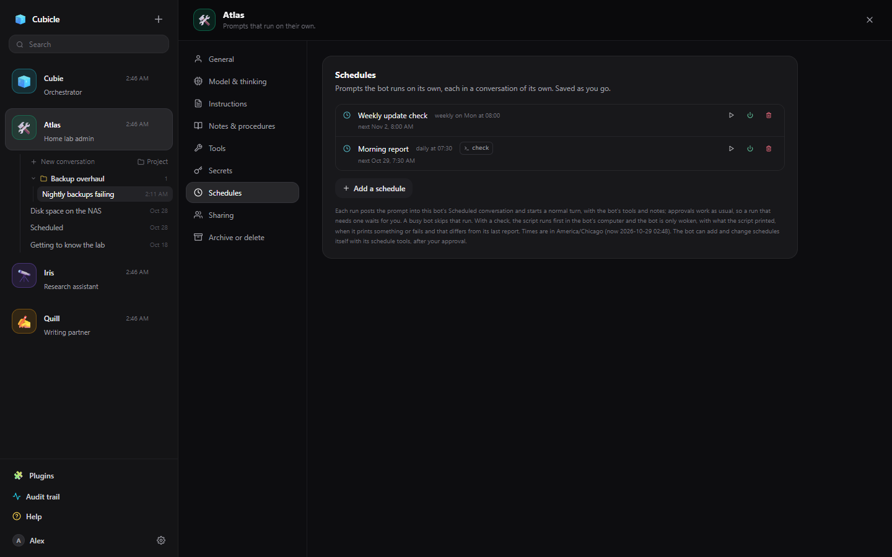
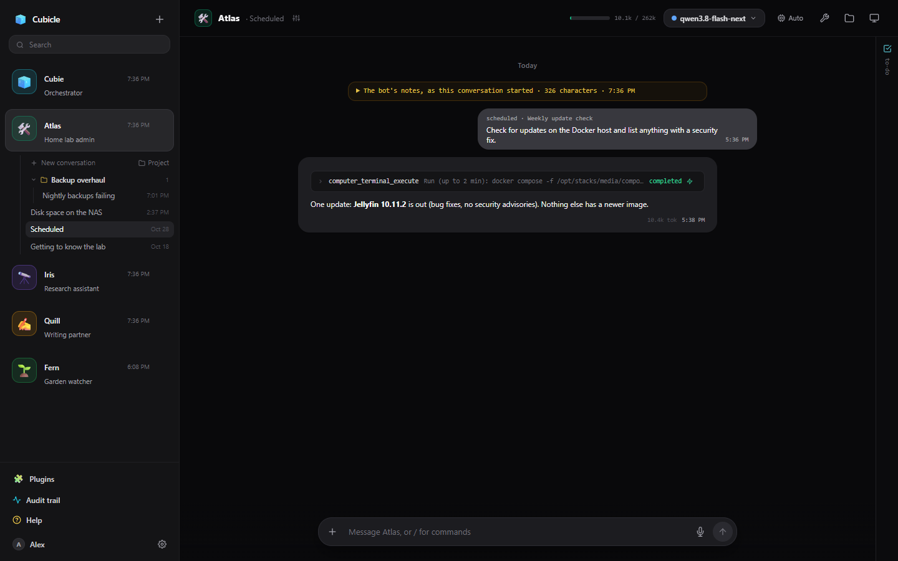

# Schedules

A schedule is a prompt a bot runs on its own: "check for updates every Monday at 8", "remind me at nine
tomorrow", "look at the disk space every morning and tell me only if something is wrong".

## Making one

On the bot's settings page under **Schedules**, **Add a schedule**: a name, the prompt, and when.

- **Once**, at a date and time.
- **Every** so many minutes or hours.
- **Daily** at a time.
- **Weekly** on chosen days at a time.

Times are in the server's timezone, shown on the page. You can pause a schedule, run it now, or remove
it. A bot can also make and remove schedules itself (it asks first), so "remind me tomorrow at nine" is
something you can just say.

## When it runs

The prompt is posted in the bot's **Scheduled** conversation, marked as scheduled, and an ordinary
reply starts: the bot has its tools, notes and computer, and approvals work as usual. A run that needs
an approval waits for you (with [auto-approval](approvals.md#auto-approval) and the right trusted tools,
a bot can run unattended). If the bot is still busy with the last run, that run is skipped. Runs that
fall while the server is down are not caught up.

## Checks: only wake the bot when it matters

A schedule can have a **check**: a short shell script that runs first, in the bot's computer. The bot
only wakes when the script prints something or fails, and the output differs from the last report. A
check like `df -h | awk '$5+0 > 90'` costs nothing on a quiet day and brings the bot in when a disk is
nearly full.
