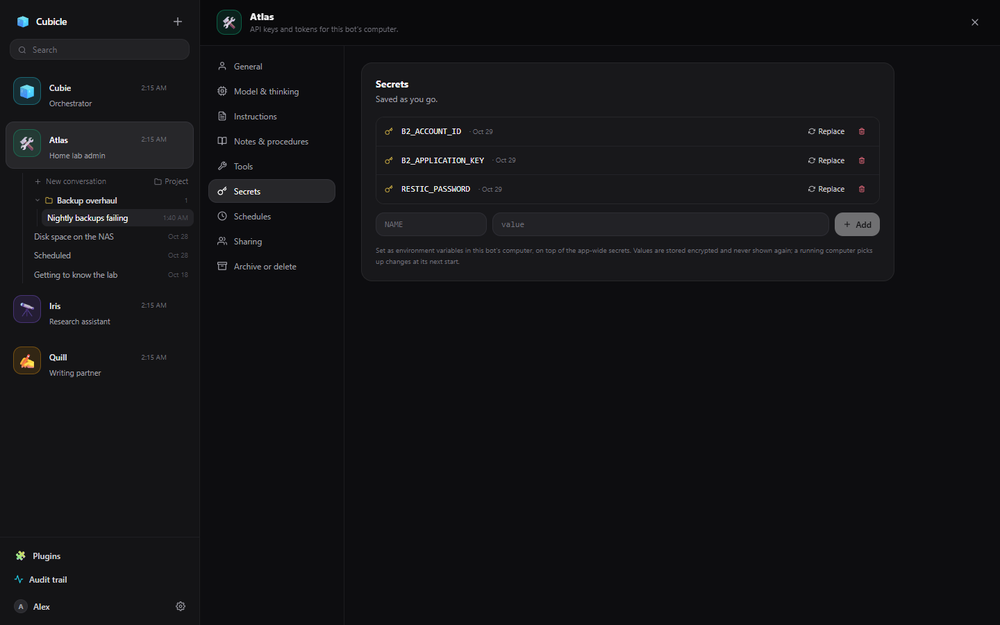

# Secrets

Secrets are API keys, tokens and passwords a bot uses without ever seeing them.

## Where to add them

- **App Settings → Secrets**: for all your bots.
- **Bot settings → Secrets**: for one bot. A bot secret overrides an app-wide one with the same name.

Values are stored encrypted and never shown again; you can replace or delete a secret, not read it.

## How a bot uses them

Secrets reach a bot only as **environment variables inside its [computer](computer.md)**, read when the
computer starts (a running computer picks up a change at its next start). The bot is told the names,
never the values, and uses them by name: `$B2_APPLICATION_KEY` in the shell, `os.environ` in Python.

[MCP servers](apps-and-mcp.md#mcp-servers) use them too: write `$NAME` in a server's environment or
headers and the secret is filled in when the server starts.

## What it protects against, and what it doesn't

Everything that comes back from a tool is scrubbed of your secrets' values before the model, the chat
or the audit trail sees it, including the common ways a shell prints them (base64, hex, URL-encoded).
That is a guard against accidents, not a boundary: it does not read screenshots, and a value cut in half
or transformed some other way gets through. A bot that has a key in its computer can use that key
anywhere its shell can reach, which is what the key is there for. Give a bot the keys its job needs, and
scope them to that job (one bucket, read-only, and so on) where the service allows.
