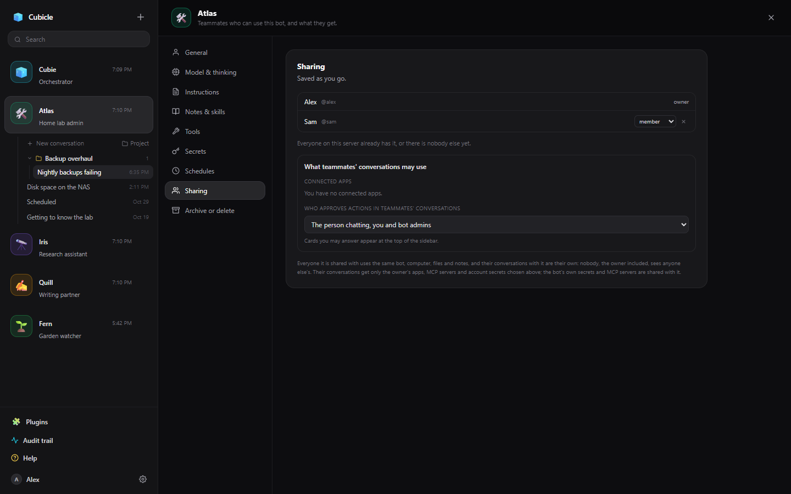
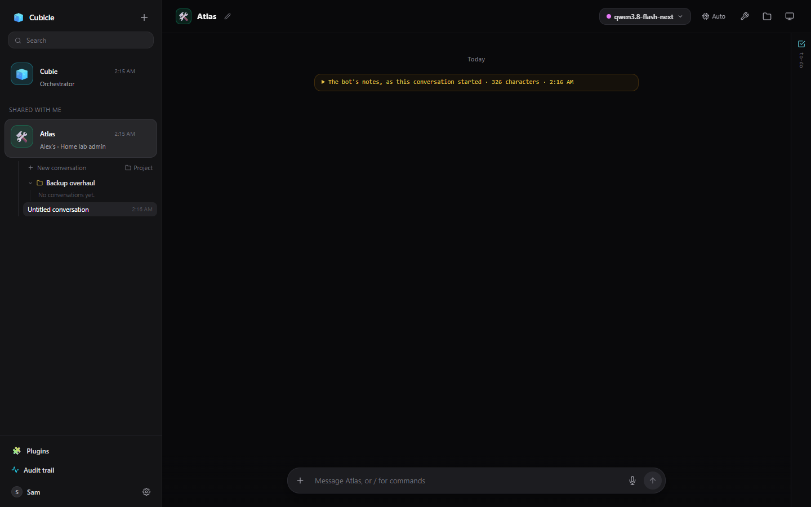

# Sharing a bot

Several people can use one Cubicle server, each with their own account, bots, conversations and
settings. You can share a bot of yours with teammates: the same bot, with its instructions, notes,
tools and computer, while each person's conversations with it stay their own.

## Sharing

On the bot's settings page under **Sharing**, add a teammate and pick a role:

- **Member**: chats with the bot and changes its settings, notes and schedules.
- **Bot admin**: also adds and removes members, and can reset the bot's computer.

Archiving, deleting and making a bot an orchestrator stay with its owner.

## What teammates' conversations may use

You decide, under **What teammates' conversations may use**:

- **Connected apps**: for each of your apps, whether a teammate's conversation uses your connection or
  their own account (they then connect it themselves).
- **Your MCP servers** and **your account secrets**: on or off. The bot's own secrets and its own MCP
  servers come with the bot either way.
- **Who approves actions in teammates' conversations**: the person chatting, you and bot admins; the
  person chatting or anyone the bot is shared with; or only the person chatting. Cards you may answer
  appear at the top of your sidebar.

## Using a bot someone shared with you

Bots shared with you appear under **Shared with me** in the sidebar, with the owner's name. Your
conversations with it are yours; the owner's are not shown to you, and yours are not shown to them. The
bot's computer, files, notes and projects are the bot's, so you share those. To stop using it, open its
settings and choose **Leave**.

## Accounts

An admin makes accounts in App Settings → Users (see [App Settings for admins](admin/settings.md#users)).
Each person can change their password, turn on two-factor authentication, and make API tokens for
scripts in Settings → Account.
