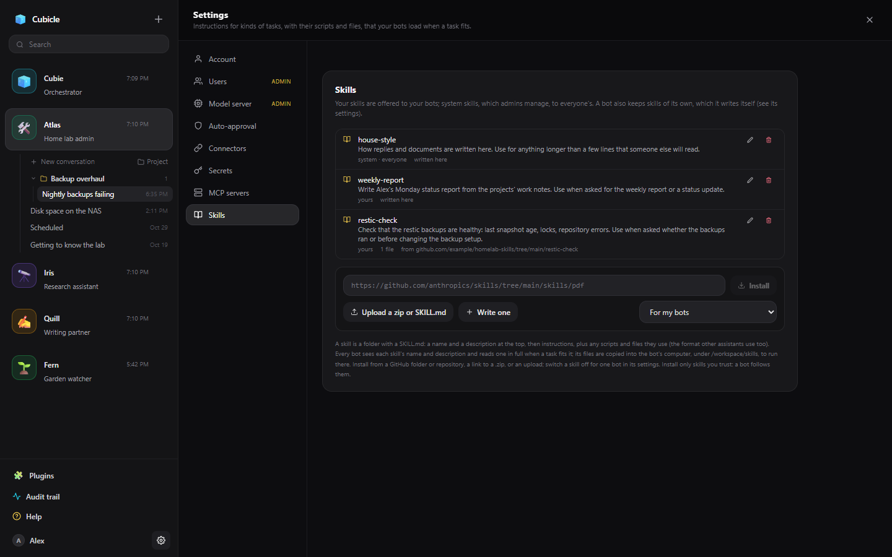

# Skills

A skill is a set of instructions for a kind of task (filling in PDF forms, writing the weekly report,
renewing a certificate), with any scripts, templates and reference files the instructions use. A bot
sees the name and description of every skill it has and reads one in full when a task fits it, so a
large library costs little until a skill is needed.

Skills use the open **Agent Skills** format that other assistants use too: a folder with a `SKILL.md`
whose top gives a `name` and a `description`, followed by the instructions in Markdown:

```markdown
---
name: weekly-report
description: Write the Monday status report. Use when asked for the weekly report or a status update.
---

1. Read the work notes of every active project.
2. ...
```

Other files in the folder (`scripts/`, `reference/`, templates) are read or run only when the
instructions call for them.

## The library

App Settings → **Skills** lists your skills, and the system skills an admin added for every account.



- **Install** from a link:
  - a GitHub folder holding a skill, such as
    `https://github.com/anthropics/skills/tree/main/skills/pdf`
  - a whole repository, which installs every skill in it
  - a link to a `.zip`
  - a link to a single `SKILL.md`
- **Upload** a `.zip` of one or more skill folders, or a lone `SKILL.md`.
- **Write one** here: a name, a description and the instructions.
- The pencil edits a skill's name, description and instructions; its other files stay as they are.
  Installing a skill with the same name again replaces it with the new version.

Write the **description** for the bot: what the skill does and when to use it. The bot decides from it
alone whether to read the skill.

Only install skills you trust. A bot follows a skill's instructions, and its scripts run in the bot's
computer (with the usual [approvals](approvals.md) for commands).

## A bot's skills

Every bot has every library skill unless you switch it off: bot settings → **Notes & skills** →
**Skills**.

When a bot reads a skill, its files are copied into the bot's computer under `/workspace/skills/<name>`,
and paths in the instructions are relative to that folder, so a skill's scripts run there. The copy is
replaced when the skill changes. A bot without a computer can still read a skill and its text files.

## Skills a bot writes itself

A bot also keeps **skills of its own**: how-tos it wrote with `skill_save`, most often after you
[showed it how](computer.md#showing-the-bot-how) to do something in its computer's browser. They are
listed under **Skills this bot wrote** in its settings, where you can read and remove them, and the bot
corrects one when it learns that a step has changed. (These used to be called procedures.)

Ask a bot to "keep that as a skill" after it worked something out, and it writes one for next time.
