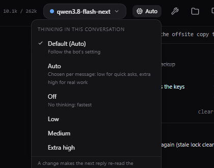

# Thinking and Auto

Models that reason think before they answer. More thinking makes them more careful on hard problems
and slower on easy ones. Cubicle lets you choose how much, per bot and per conversation.

## The levels

The chip in the chat header shows the level the conversation uses; click it to change it. The levels on
offer are the ones your model understands (an admin sets them); typically:

| Level | When to use it |
| --- | --- |
| **Off** | No thinking at all: fastest, for chat and simple lookups |
| **Low** | A little thinking: quick questions, simple commands |
| **Medium** | Everyday work |
| **Extra high** | Hard problems: planning, debugging, anything where a mistake is costly |
| **Auto** | Cubicle decides per message (below) |

`/think <level>` does the same from the message box, and `/think default` goes back to the bot's
setting.

## Where the level comes from

1. The conversation's own setting (the chip, or `/think`), if you set one.
2. Otherwise the bot's setting ([Bot settings](bots.md) → Model & thinking).
3. Otherwise the app's default (App Settings → Model server → Reasoning effort).

The first thinking block of each reply says which level it used, and `auto` when Auto picked it.

## Auto

With **Auto**, a small decision model looks at each message before the reply starts and asks two
questions: does it need careful, multi-step reasoning, and would a careless answer do real harm? A clear
no to both gets **Low**; anything else gets **Extra high**. "Thanks!" or "what time is it in Tokyo?" is
answered quickly; "the backup failed, find out why" gets the full treatment.

Auto needs the decision server that [auto-approval](approvals.md#auto-approval) uses. Without one, Auto
falls back to the level the conversation last used, or Extra high.

## For admins

How the level reaches the model, and which levels are offered, is set on the server
(`THINKING_LEVELS`, `THINKING_STYLE`; see [Configuration](admin/configuration.md#thinking)). With
Qwen3.8 Flash Next on halogen-flash-server, `THINKING_STYLE=hint` keeps one prompt cache per
conversation whatever the level, so switching levels costs nothing.
